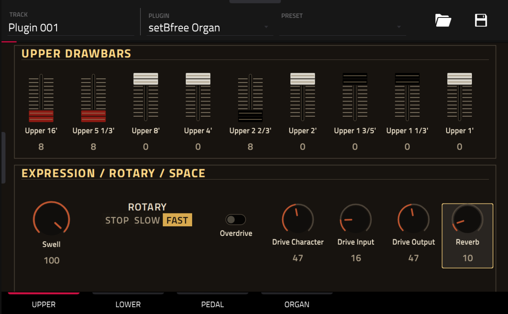

# setBfree Organ for MPC OS

A native VST2 port of the [setBfree](https://github.com/pantherb/setBfree)
tonewheel organ engine for first-generation Akai MPC standalone devices and
Force. It runs in MPC's plugin host and has a native touchscreen skin.



The current release is **0.1.12**. It provides:

- upper, lower and pedal drawbars with traditional colour groups;
- touchscreen, Data Wheel and Q-Link control;
- percussion, vibrato/chorus, swell, overdrive, reverb and rotary speed;
- one-keyboard operation with optional upper/lower or upper/lower/pedal splits;
- VST chunk state for project save and reload.

Every incoming channel-voice message is routed to setBfree's upper-manual MIDI
channel. With split mode disabled, the whole keyboard drives the upper manual.
The two split modes use setBfree's native channel-A key map. MIDI note ranges in
the engine are upper/lower C2-C7 (36-96) and pedal C1-C3 (24-49).

## Install

Download `setBfree-Organ-0.1.12-mpc-armv7.zip` from the GitHub release and
follow the included `INSTALL.md`. Installation requires root SSH access to a
first-generation MPC OS device and restarts the MPC application.

## Build and test

The build uses the public
[mpc-vst-plugins](https://github.com/SamplingHigh/mpc-vst-plugins) porting kit. Clone
both repositories, check out the tested porting-kit revision, then point
`MPC_VST` at the kit:

```sh
git clone https://github.com/SamplingHigh/mpc-vst-plugins.git
git -C mpc-vst-plugins checkout 66eca176028b5fd63622dd7769451d5e28eb11a1
git clone https://github.com/SamplingHigh/mpc-vst-setbfree.git
cd mpc-vst-setbfree
MPC_VST=../mpc-vst-plugins ./test.sh
MPC_VST=../mpc-vst-plugins ./build.sh
```

`build.sh` needs Docker with ARMv7/QEMU support. If an
`arm-linux-gnueabihf-gcc` toolchain is installed, use `build-cross.sh` instead.
HTML skin artwork also needs Python, Pillow and Playwright Chromium; set
`HTML_ART_PY` when that Python interpreter is outside the default path.

For a catalog-compatible build without Docker, install Zig and run:

```sh
ZIG=/path/to/zig ./build-zig.sh
```

This targets ARM hard-float with glibc 2.31 compatibility. The 0.1.12 release
binary has a highest required GLIBC symbol of 2.29.

## Source and licence

This complete port is distributed under **GPL-2.0-or-later**. The full licence
text is in [LICENSE](LICENSE).

The setBfree engine source is vendored under `src/dsp` from upstream commit
[`2f41983b5b535bda9b1b1db38a06da29d50ff557`](https://github.com/pantherb/setBfree/tree/2f41983b5b535bda9b1b1db38a06da29d50ff557).
Its original copyright and GPL notices are preserved. The MPC host adapter,
parameter definitions, skin sources and build scripts are included in this
repository, so the published source corresponds to the released binary.

See [THIRD_PARTY_NOTICES.md](THIRD_PARTY_NOTICES.md) and
[`src/VENDORED.md`](src/VENDORED.md) for provenance and the exact vendoring
changes. No Akai plugin code or artwork is included. Akai and MPC are trademarks
of their respective owners; this project is independent and unofficial.
