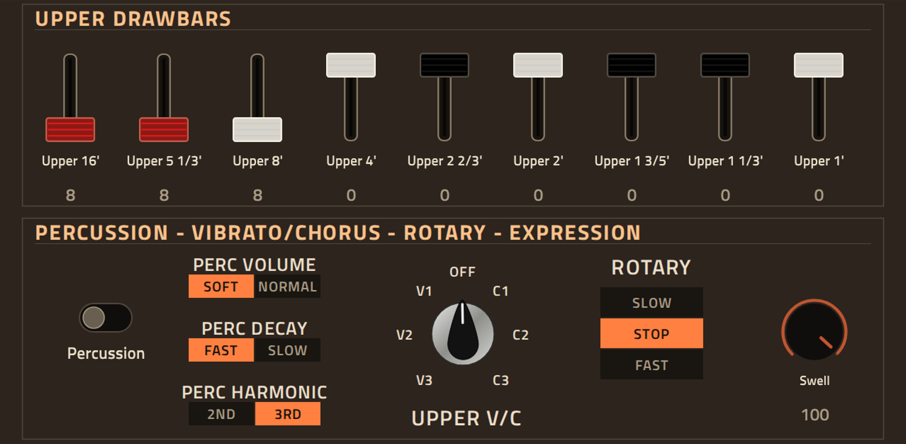
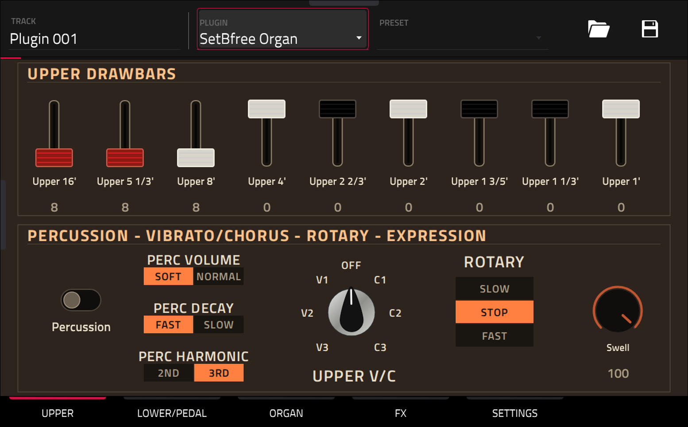
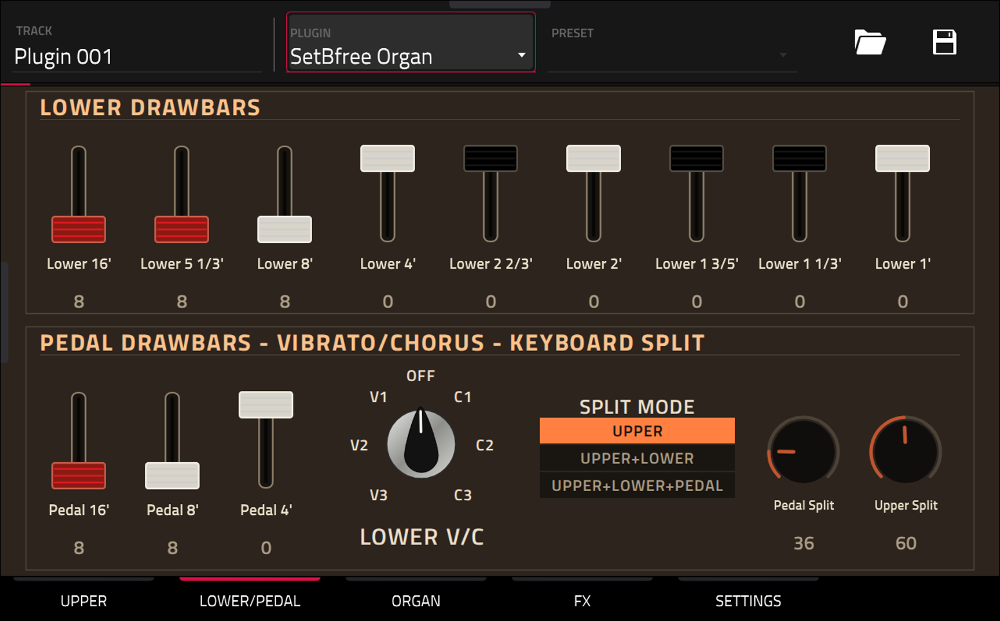
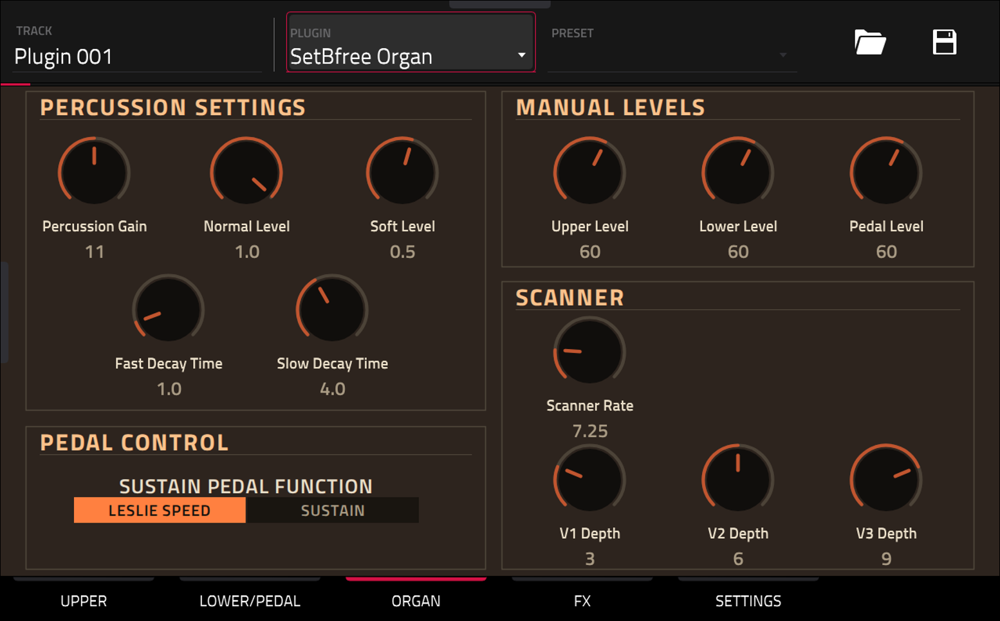
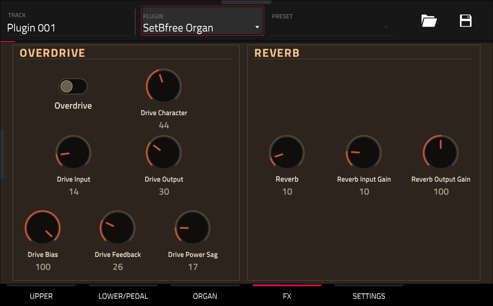
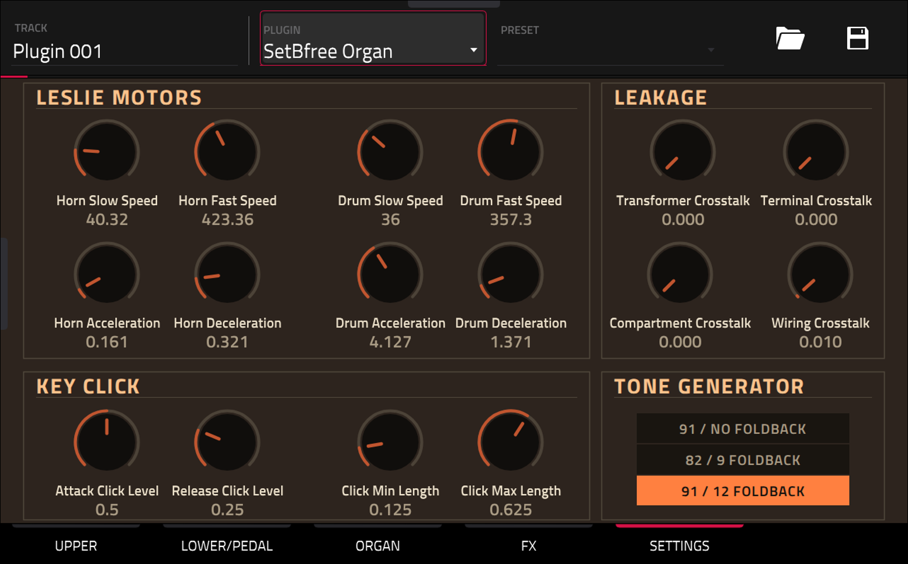

# setBfree Organ for MPC OS

A native VST2 port of the [setBfree](https://github.com/pantherb/setBfree)
tonewheel organ engine for Akai MPC standalone devices and Force. It runs in
MPC's plugin host and has a native touchscreen skin. The ARMv7 release is
verified on Force; the aarch64 Gen2 build is experimental and has not yet been
run on Gen2 hardware.



The current release is **0.3.1**. It provides:

- upper and lower drawbars with traditional colour groups, plus 16', 8' and 4'
  pedal controls;
- touchscreen, Data Wheel and Q-Link control, including MPC's page-following
  KNOBS screen;
- a five-page UPPER, LOWER/PEDAL, ORGAN, FX and SETTINGS touchscreen layout;
- percussion, per-manual vibrato/chorus, scanner, swell and manual-level
  controls;
- editable overdrive, reverb, Leslie motor, key-click and leakage parameters;
- switchable sustain-pedal or Leslie-speed pedal operation;
- one-keyboard operation with optional upper/lower or upper/lower/pedal splits;
- VST chunk state for project save and reload.

## Screens











Every incoming channel-voice message is routed to setBfree's upper-manual MIDI
channel. With split mode disabled, the whole keyboard drives the upper manual.
The two split modes use setBfree's native channel-A key map. MIDI note ranges in
the engine are upper/lower C2-C7 (36-96) and pedal C1-C3 (24-49).

The normal audio path measured 8.9% p99 and 12.4% worst-block CPU at 16 voices
on a Force. Changing one of the four leakage/crosstalk settings rebuilds the
organ core and can briefly mute audio; these controls are therefore on the
SETTINGS page and are intended for sound setup rather than performance moves.

## Install

Download the package for the device from the GitHub release and follow its
included `INSTALL.md`:

- `setBfree-Organ-0.3.1-mpc-armv7.zip`: scripted installer for Force and
  first-generation MPCs;
- `setBfree-Organ-0.3.1-mpc-sdk.zip`: MPC OS 3.10.1 folder format for Force
  and first-generation MPCs. Unzip it and copy the plugin folder into a drive's
  `VST2 Plugins` directory.

The SDK-format package needs no root access on MPC OS 3.10.1. The scripted
ARMv7 installer also supports the earlier `Synths` layout and restarts the MPC
application. Release 0.3.1 keeps the same plugin UID, parameter indices and
state format as 0.3.0, so saved projects remain compatible. The experimental
Gen2 build remains available only on the project page and is not advertised in
the public catalog until it has been verified on physical Gen2 hardware.

## Build and test

The build uses the public
[mpc-vst-plugins](https://github.com/open-mpc/mpc-vst-plugins) porting kit. Clone
both repositories, check out the tested porting-kit revision, then point
`MPC_VST` at the kit:

```sh
git clone https://github.com/open-mpc/mpc-vst-plugins.git
git -C mpc-vst-plugins checkout 0dc17120cd7e952e95eeecdd820ac9e495a75ee9
git clone https://github.com/SamplingHigh/mpc-vst-setbfree.git
cd mpc-vst-setbfree
MPC_VST=../mpc-vst-plugins ./test.sh
MPC_VST=../mpc-vst-plugins ./test.sh aarch64
MPC_VST=../mpc-vst-plugins ./build.sh all
```

`build.sh` needs Docker with ARMv7 and ARM64/QEMU support. `build.sh armv7` or
`build.sh aarch64` selects one target; the default builds both. If an
`arm-linux-gnueabihf-gcc` toolchain is installed, use `build-cross.sh` instead.
HTML skin artwork also needs Python, Pillow and Playwright Chromium; set
`HTML_ART_PY` when that Python interpreter is outside the default path.

For a catalog-compatible build without Docker, install Zig and run:

```sh
ZIG=/path/to/zig ./build-zig.sh
MPC_VST=../mpc-vst-plugins ZIG=/path/to/zig ./build-zig-aarch64.sh
```

For layout and artwork changes, `build-skin.sh` regenerates only the skin. On
Windows, `Update-SkinOnForce.bat` builds that skin, uploads only `Plugin Skins`
and restarts the MPC application without replacing the plugin binary. Set
`FORCE_HOST`, pass `-ForceHost` to the PowerShell script, or put the device
address in a local `.force-host` file.

The 0.3.1 ARMv7 binary targets ARM hard-float with glibc 2.31 compatibility and
is verified on Force MPC OS 3.10.1. The source also supports an aarch64 Gen2
build, but that target remains hardware-unverified and is deliberately not
submitted to the public plugin catalog yet.

## Source and licence

This complete port is distributed under **GPL-2.0-or-later**. The full licence
text is in [LICENSE](LICENSE).

The setBfree engine source is vendored under `src/dsp` from upstream commit
[`2f41983b5b535bda9b1b1db38a06da29d50ff557`](https://github.com/pantherb/setBfree/tree/2f41983b5b535bda9b1b1db38a06da29d50ff557).
Its original copyright and GPL notices are preserved. The MPC host adapter,
parameter definitions, skin sources and build scripts are included in this
repository, so the published source corresponds to the released binary.

See [THIRD_PARTY_NOTICES.md](THIRD_PARTY_NOTICES.md) and
[`src/VENDORED.md`](src/VENDORED.md) for provenance and the exact vendoring
changes. No Akai plugin code or artwork is included. Akai and MPC are trademarks
of their respective owners; this project is independent and unofficial.
